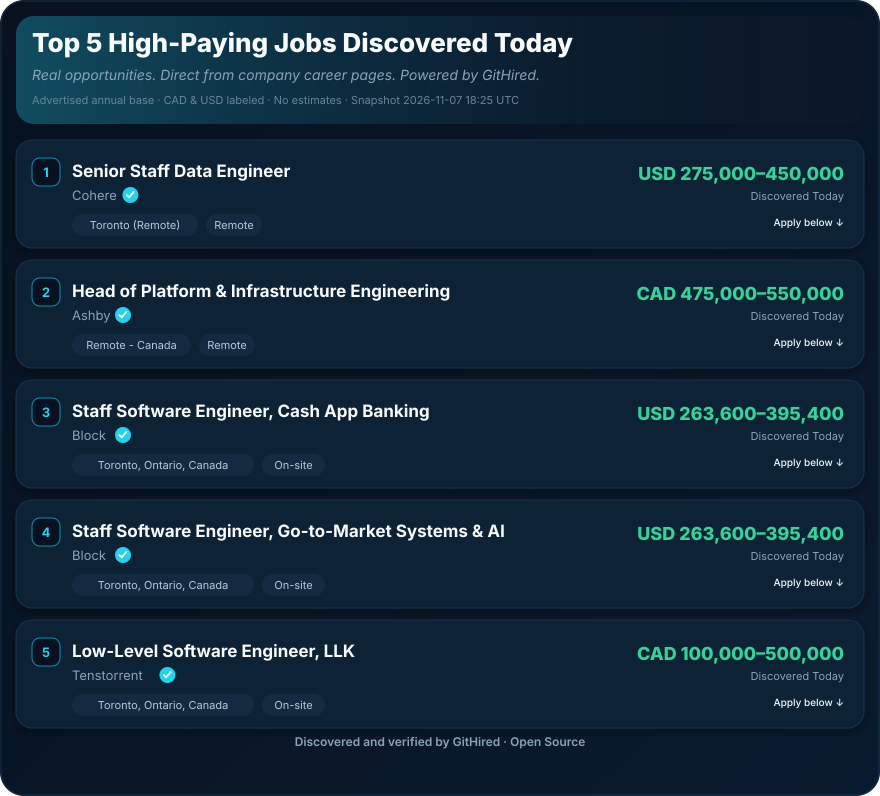

<p align="center">
  
</p>

<h1 align="center">GitHired</h1>

<p align="center">
  <strong>Jobs Without the Noise.</strong><br />
  Canada-first discovery for software, AI, data &amp; cloud engineers.<br />
  Public ATS boards → hard Canada filters → ranked shortlist — no API key required.
</p>

<p align="center">
  <a href="https://github.com/mikegianfelice/GitHired/actions/workflows/ci.yml"></a>
  
  
  
</p>

<p align="center">
  <a href="https://githired.ca"><strong>Browse Jobs</strong></a> ·
  <a href="https://githired.ca/developers"><strong>REST API</strong></a> ·
  <a href="https://githired.ca/agents"><strong>MCP / Agents</strong></a> ·
  <a href="#quick-start"><strong>Install CLI</strong></a> ·
  <a href="#top-5-high-paying-jobs-discovered-today"><strong>Top salaries</strong></a> ·
  <a href="SETUP.md">Setup guide</a> ·
  <a href="docs/discovery.md">Discovery docs</a>
</p>

---

## Browse Jobs Online

**No install. No account. No API key.**

**https://githired.ca** — public shortlist, REST API docs, and MCP agent onboarding.

| Public site / API | Personalized CLI |
| ----------------- | ---------------- |
| Confirmed Canada-eligible engineering listings | Your tracks, city, salary floor, digests |
| Search, salary slider, and filters in the browser | `githired discover` → `enrich` → `rank` → `jobs` |
| REST: `https://api.githired.ca` · MCP: `https://api.githired.ca/mcp` | Cursor `/apply` CV + cover letter (with your approval) |
| Optional **Find My Matches** (local résumé / profile) | Private SQLite + profile on your machine |

### Connect an AI agent (MCP)

One-click for **Cursor** (official deeplink) and copyable setup for Claude / ChatGPT:

**https://githired.ca/agents**

```json
{
  "mcpServers": {
    "githired": {
      "url": "https://api.githired.ca/mcp"
    }
  }
}
```

### Public site features

- **Browse Jobs** — client-side search, province / arrangement / seniority filters, sort (salary, recent, company).
- **Minimum Salary (CAD)** — interactive slider ($0–$300k+, $10k steps). Uses advertised annual base; USD converted with the published FX (default ×1.35) for filtering only. Employer currency and range stay on the card. Undisclosed pay is optional via checkbox — never estimated.
- **Find My Matches** — optional. Paste experience, enter preferences, or parse a PDF/DOCX/TXT **in the browser**. Deterministic relevance scoring (title, skills, seniority, discipline, preferences). Geography is a hard filter. Not an LLM and not a guarantee of fit.
- **Privacy** — résumés are not uploaded to GitHub, Actions, or external AI. Saving a profile is explicit and uses `localStorage` only; **Clear My Profile** removes it. Clearing browser data also clears it.

The website is a zero-install shortlist. The CLI remains the place for private digests, config-driven floors, and application drafting.

Local preview of the static shell:

```bash
cd site && python3 -m http.server 8080
# open http://127.0.0.1:8080/
```

---

<!-- TOP-PAYING-JOBS:START -->

## Top 5 High-Paying Jobs Discovered Today

*Real opportunities. Direct from company career pages. Powered by GitHired.*

<p align="center"></p>

**Apply directly:** [1. Cohere ↗](https://jobs.ashbyhq.com/cohere/4ef5101e-b083-49cd-808a-54c754d159e5/application) · [2. Ashby ↗](https://jobs.ashbyhq.com/Ashby/7f0f3837-3433-4ffe-8842-f3dbc3b621da/application) · [3. Block ↗](http://block.xyz/careers/jobs/5196196008?gh_jid=5196196008) · [4. Tenstorrent ↗](https://job-boards.greenhouse.io/tenstorrent/jobs/5260226007) · [5. GitLab ↗](https://job-boards.greenhouse.io/gitlab/jobs/8853843002)

<p align="center"><strong>Discovered and verified by GitHired · Open Source</strong></p>

<p align="center"><a href="#quick-start"><strong>Get Started with GitHired →</strong></a></p>

<details>
<summary>Ranking & eligibility rules</summary>

Rank by advertised annual base salary high end, converted to CAD for sorting only (USD×1.35; other currencies excluded). Display the employer-stated currency and range unchanged. No estimates for undisclosed pay.

- Snapshot refreshed: **2026-11-11 20:59 UTC** (preserved on failure — never backdated).
- Blue ✓ marks listings confirmed against a direct employer career / ATS URL.
- SVG cards are visual only on GitHub; use **Apply directly** links below the image (order matches card numbers 1–N).
- **Discovered Today** is shown only when the job’s `first_seen` date is today; otherwise the card shows the last verified date.
- Advertised annual base only (CAD / USD); no estimates for undisclosed pay.
- Fewer than five cards means fewer than five qualified.

</details>

<!-- TOP-PAYING-JOBS:END -->

---

## Why GitHired

Stop re-running the same LinkedIn and careers-page searches. GitHired pulls public employer boards, keeps only **Canada-eligible** engineering roles, ranks them against *your* profile, and can email a daily shortlist — while CV drafting and applications stay behind **your** approval.

| You get | You don’t get |
| ------- | ------------- |
| Greenhouse, Lever, Ashby, Workable, Rippling, Workday guest boards, RSS | Invented Canadian eligibility |
| Deterministic ranking with no API key | Auto-submitted applications |
| Optional LLM stage-2 + email digest | Affiliate “apply” spam in your confirmed list |
| Cursor `/apply` for tailored CV + cover letter | A black-box scrape of LinkedIn’s ToS |

Built by **[Michael Gianfelice](https://www.linkedin.com/in/michaelgianfelice/)** — Toronto engineer and technical consultant.

---

## Demo

```bash
git clone https://github.com/mikegianfelice/GitHired.git
cd GitHired
python3 -m pip install -e ".[dev]"   # Python 3.10+ (3.11+ recommended on macOS)
githired setup                       # province, city, tracks, salary — interactive
githired doctor
githired discover                    # listings only (fast); browse while enriching
githired enrich                      # priority + fair Workday detail queue (resumable leases)
githired rank                        # confirmed scores (complete jobs only)
githired jobs                        # confirmed matches only (never pads with off-track)
githired digest
```

**One-liner daily loop:** `githired refresh` (progressive enrich→rank; reports TTF10) or `githired run-daily`  
**Statuses:** *discovered* → *enriched* → *confirmed eligible*  
**Relevance ≠ Canada eligibility:** off-track titles are IRRELEVANT, not “uncertain Canada”.  
**Agent apply flow:** `/apply <job-url>` (asks before drafting)

---

## Quick start

### 1. Fork and clone

```bash
gh repo fork mikegianfelice/GitHired --clone
cd GitHired
gh repo set-default <your-github-username>/GitHired
```

Or clone without forking: `git clone https://github.com/mikegianfelice/GitHired.git`

> **Before you go further: forks are public.** GitHub cannot make a fork of a public
> repository private, and setup writes your **personal data** into tracked files
> (`CLAUDE.md`, profile YAMLs). Pushing those commits to a public fork publishes them.
> Prefer a **private** repository with this repo as `upstream` — see [SETUP.md](SETUP.md)
> section 8 for the private-remote recipe.

### Prerequisites

| | |
| --- | --- |
| **Python 3.10+** | Required (`brew install python@3.11` if macOS `python3` is 3.9) |
| **Cursor** *(recommended)* | Agent workflows via `.cursor/` skills |
| **LLM / SerpAPI** *(optional)* | Stage-2 ranking / paid LinkedIn index only |
| **Bun / LaTeX** *(optional)* | Portal CLIs / `/apply` PDF compile |

### Install

```bash
# From your private clone or fork (see §1)
cd GitHired
# macOS tip: system python3 is often 3.9 — use Homebrew 3.11+
python3 -m pip install -e ".[dev]"
githired setup          # interactive: province, city, tracks, salary
githired doctor         # what works without API keys
```

**Works without API keys:** `discover` (public ATS + Workday guest boards), deterministic `rank`, `jobs`, `digest`.  
**Optional:** Anthropic/OpenAI for stage-2 ranking; SMTP/Resend for email digests; SerpAPI for LinkedIn index; Bun for portal CLIs; LaTeX for `/apply` PDFs.

Workday boards hydrate posting details and can take **20–45+ minutes** on a full run — progress logs show company, boards completed, jobs fetched, and elapsed time. Use `config/search.yaml` `workday_company_budget_s` to bound per-company time (complete mode remains available).

Non-interactive / CI:

```bash
githired setup --non-interactive \
  --tracks data_engineering analytics_engineering \
  --modes remote_canada hybrid \
  --province ON --city Toronto \
  --salary-cad 130000 \
  --skills Python SQL Databricks Spark Azure Airflow \
  --years 7 --name "Your Name" \
  --seniority-include mid senior staff
```

Optional config after setup: [`config/profile.yaml`](config/profile.yaml), [`config/search.yaml`](config/search.yaml), [`config/companies.local.yaml.example`](config/companies.local.yaml.example).

### Discover → rank → shortlist

```bash
githired companies discover   # optional board expansion
githired discover             # list-only
githired enrich               # most promising Workday details first
githired rank                 # optional --limit N; --llm for stage-2
githired jobs                 # confirmed shortlist
githired jobs --eligibility uncertain   # relevant roles with ambiguous geo only
githired refresh              # discover → enrich → rank loops; TTF10 metrics
githired digest
githired run-daily            # refresh-style pipeline + digest [--email] [--companies]
```

LinkedIn is optional (free index is best-effort; SerpAPI / alert import available). **Freehire.me** is off by default. Details: [docs/discovery.md](docs/discovery.md).

### Apply with approval

```text
/apply <job-url>
```

```bash
githired prepare <job_id>   # briefing only — never drafts or submits
```

---

## Canada market defaults

- **Geographic eligibility:** ELIGIBLE · UNCERTAIN · INELIGIBLE (plus IRRELEVANT for off-track titles) — never invented from a global brand alone ([`jobseek/filters/hard.py`](jobseek/filters/hard.py))
- **Relevance** (MATCH / NO_MATCH / REVIEW) is reported separately from Canadian eligibility
- **Salary policy:** `flexible` (default) · `strict` · `none` — preferred currency + explicit `usd_to_cad` (never 1:1); setup does not invent a USD floor
- **Uncertain jobs:** `githired jobs --eligibility uncertain` shows root causes and whether enrichment can help
- A Toronto-only hybrid is **not** eligible for a Vancouver candidate who will not relocate
- Engineering **tracks** in [`config/search.yaml`](config/search.yaml): software, AI, ML, data, platform, cloud, DevOps/SRE, FDE
- Seniority mid+ by default; internships / co-ops / new-grad / junior excluded unless enabled
- Salary floors configurable (CAD / USD)
- Day-1 install works without hand-editing a company list; boards expand via `githired companies discover`
- **No paid APIs** required for core ATS + Workday discovery and deterministic ranking

---

## Commands

### `githired` CLI (`jobseek` alias)

| Command | What it does |
| ------- | ------------ |
| `setup` | Interactive / non-interactive config + legacy migrate |
| `doctor` / `sources` | Environment and company/source health |
| `companies discover` | Discover and validate public ATS boards |
| `companies validate` / `list` / `stats` / `export` / `import` | Registry ops |
| `discover` | List-only fetch from enabled boards (+ optional LinkedIn) |
| `enrich` | Priority + fair Workday detail hydration (leases / retries) |
| `refresh` | Progressive discover → enrich → rank; reports TTF10 |
| `rank` | Deterministic Stage-1; `--llm` for Stage-2 |
| `jobs` | Confirmed shortlist (never pads with UNCERTAIN / IRRELEVANT) |
| `digest` / `email-digest` | Top-N shortlist; optional email |
| `run-daily` | discover → enrich → rank → digest → email |
| `showcase-readme` | Refresh README Top Paying section from DB / snapshot |
| `prepare` | Briefing only; no auto-draft/submit |
| `migrate` / `import-seen` / `import-alerts` | Legacy + LinkedIn alert import |
| `sync-application` | Record an application into SQLite |

### Agent workflows (Cursor)

| Command | What it does |
| ------- | ------------ |
| `/setup` | Build profile from documents, CV, or interview |
| `/scrape` | Portal CLI search (legacy / interactive) |
| `/rank` | Agent triage of scraped jobs |
| `/apply` | Fit eval + tailored CV/cover letter (asks before drafting) |
| `/interview` | Stage-specific prep + mock interview |
| `/outcome` | Track results and archive materials |

Full list: [SETUP.md](SETUP.md) · [`.claude/commands/`](.claude/commands/).

---

## Architecture (high level)

```
GitHired/
├── jobseek/                 # Discovery, filters, ranking, digest, showcase
│   ├── adapters/            # Greenhouse, Lever, Ashby, Workable, RSS, Rippling, Workday, …
│   ├── companies/           # Registry merge, validation, discovery
│   └── showcase/            # README Top Paying Jobs refresh
├── config/                  # companies.yaml, search.yaml, profile.yaml
├── registry/community/      # PR-based public company registry
├── docs/discovery.md        # Pipeline + Canada eligibility
├── docs/showcase/           # Snapshot + showcase architecture
├── .cursor/ · .claude/      # Agent skills & canonical workflows
├── .agents/skills/          # Optional portal CLIs
└── SETUP.md
```

Scheduled README salary refresh: [docs/showcase/ARCHITECTURE.md](docs/showcase/ARCHITECTURE.md).

---

## Security

Job postings are **untrusted input**. Agent workflows strip hidden text and refuse instructions embedded in ads ([SECURITY.md](SECURITY.md)). Keep `.env` and personal trackers out of git. Company discovery never uploads profiles, application history, or API keys.

---

## About

**Michael Gianfelice** — Toronto, Ontario  
Technical Consultant · data systems, automation, AI-assisted workflows

- LinkedIn: [linkedin.com/in/michaelgianfelice](https://www.linkedin.com/in/michaelgianfelice/)
- GitHub: [github.com/mikegianfelice](https://github.com/mikegianfelice)

## License

MIT — see [LICENSE](LICENSE).
